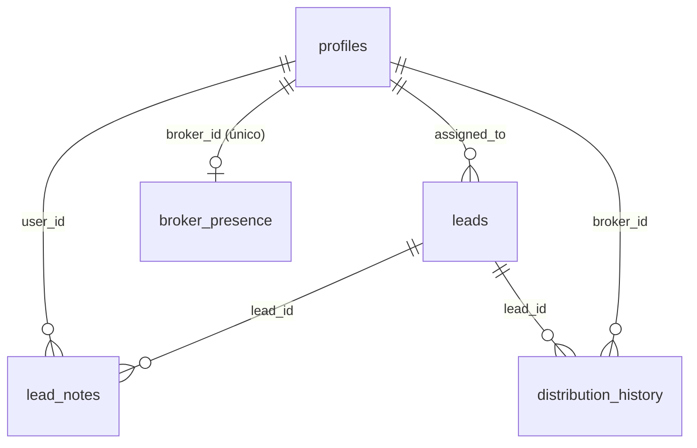

# San Remo CRM — Leads, presença por QR Code e roleta Round-Robin

CRM imobiliário desenvolvido para o desafio técnico Full Stack da **San Remo Imóveis**. O gestor cadastra e acompanha leads, os corretores confirmam presença lendo um QR Code que muda a cada 5 minutos, e a roleta distribui os leads do reservatório entre os corretores presentes numa fila circular contínua.

Toda regra crítica (permissões, presença, distribuição) roda **no banco**, com Row Level Security e funções PostgreSQL transacionais. O frontend nunca decide quem recebe um lead.

---

## Sumário

1. [Objetivo](#1-objetivo)
2. [Tecnologias](#2-tecnologias)
3. [Executar localmente](#3-executar-localmente)
4. [Configurar o Supabase](#4-configurar-o-supabase)
5. [Executar as migrations](#5-executar-as-migrations)
6. [Usuários de demonstração](#6-usuários-de-demonstração)
7. [Variáveis de ambiente](#7-variáveis-de-ambiente)
8. [Publicar na Vercel](#8-publicar-na-vercel)
9. [Reproduzir os fluxos principais](#9-reproduzir-os-fluxos-principais)
10. [Uso de IA no desenvolvimento](#10-uso-de-ia-no-desenvolvimento)
11. [Como o código foi validado](#11-como-o-código-foi-validado)
12. [Limitações conhecidas](#12-limitações-conhecidas)
13. [Arquitetura e decisões técnicas](#13-arquitetura-e-decisões-técnicas)

---

## 1. Objetivo

| Perfil | O que faz |
|---|---|
| **Gestor** | Vê todos os leads (Kanban ou tabela, com filtros), cadastra e edita leads, consulta o reservatório, exibe o QR Code de presença, acompanha a fila de corretores, aciona a distribuição e consulta o histórico. |
| **Corretor** | Vê apenas os próprios leads, muda a etapa (arrastando no Kanban ou no painel do lead), registra observações e confirma presença pelo QR Code. |

Etapas do funil: **Novo → Em contato → Visita agendada → Proposta → Ganho / Perdido**.

## 2. Tecnologias

- **React 19 + TypeScript + Vite 6**
- **Supabase**: Postgres, Auth, Row Level Security e funções RPC (PL/pgSQL)
- **Tailwind CSS 4** com componentes no padrão **shadcn/ui** (`class-variance-authority` + `tailwind-merge` + Radix Dialog)
- **React Router 7**, **TanStack Query 5**, **React Hook Form + Zod**
- **Recharts** (gráficos), **qrcode.react** (QR Code), **date-fns** (datas em pt-BR), **lucide-react** (ícones), **sonner** (toasts)
- **Vercel** para hospedagem e **Git/GitHub** para versionamento

## 3. Executar localmente

Pré-requisitos: Node.js 20+ e um projeto Supabase na nuvem (plano gratuito). **Não é preciso instalar nada do Supabase**: tudo é feito pelo painel web.

```bash
npm install
cp .env.example .env.local     # preencha VITE_SUPABASE_URL e VITE_SUPABASE_PUBLISHABLE_KEY
npm run dev                    # http://localhost:5173
```

Scripts úteis:

| Comando | O que faz |
|---|---|
| `npm run dev` | Servidor de desenvolvimento |
| `npm run build` | Checagem de tipos (`tsc -b`) + build de produção |
| `npm run lint` | ESLint (inclui `no-explicit-any` como erro) |
| `npm run test:db` | Testes do banco num PostgreSQL local (ver seção 11) |
| `npm run demo:users` | Cria as contas de demonstração no Supabase Auth |

## 4. Configurar o Supabase

1. Crie um projeto em [supabase.com](https://supabase.com).
2. Em **Project Settings → API Keys** (ou no botão **Connect** do topo do painel), copie a **Project URL** e a **Publishable key** (`sb_publishable_…`) para o `.env.local`. Projetos antigos mostram uma **anon key** (`eyJ…`) — o app aceita as duas (`VITE_SUPABASE_PUBLISHABLE_KEY` ou `VITE_SUPABASE_ANON_KEY`).
3. Em **Authentication → Providers → Email**, mantenha o login por e-mail e senha habilitado.
4. **Recomendado:** em **Authentication → Sign In / Providers**, desative **Allow new users to sign up**. As contas são criadas pelo gestor. Mesmo com o cadastro aberto, um novo usuário sempre nasce como corretor (o papel enviado no cadastro é ignorado pelo banco), mas não há por que expor o cadastro.
5. Em **Authentication → URL Configuration**, defina o **Site URL** com o domínio de produção (ex.: `https://san-remo-crm.vercel.app`).

## 5. Executar as migrations

As migrations estão em `supabase/migrations/` e recriam o banco do zero, em ordem:

| Arquivo | Conteúdo |
|---|---|
| `…120000_core_schema.sql` | Enums, `profiles`, `leads`, `lead_notes`, triggers de perfil e de integridade dos leads |
| `…120100_presence_qr.sql` | `qr_tokens`, `broker_presence`, segredo HMAC, RPCs `get_presence_qr` e `check_in_presence` |
| `…120200_round_robin_distribution.sql` | `distribution_history`, cursor da fila, RPCs `distribute_next_lead`, `get_presence_overview`, `get_my_presence` |
| `…120300_rls_and_grants.sql` | Políticas RLS e privilégios |

**Opção A — SQL Editor do painel (sem instalar nada):** abra **SQL Editor → New query**, cole todo o conteúdo de `supabase/setup-completo.sql` (as 4 migrations juntas, na ordem) e clique em **Run**.

**Opção B — Supabase CLI (via `npx`, sem instalação global):**

```bash
npx supabase login
npx supabase link --project-ref SEU_PROJECT_REF
npx supabase db push
```

Para manter `setup-completo.sql` em sincronia após mudar uma migration, concatene os arquivos de `supabase/migrations/` na ordem.

> Não execute `supabase/tests/00_supabase_auth_shim.sql` no Supabase. Ele existe apenas para testar as migrations num Postgres puro.

## 6. Usuários de demonstração

Nenhuma senha está no código. Escolha você a senha das contas de demonstração.

| E-mail | Nome | Papel |
|---|---|---|
| `gestor@example.com` | Helena Martins | Gestora |
| `ana.lima@example.com` | Ana Lima | Corretora |
| `bruno.costa@example.com` | Bruno Costa | Corretor |
| `carla.souza@example.com` | Carla Souza | Corretora |
| `diego.rocha@example.com` | Diego Rocha | Corretor |

**Passo 1 — criar as contas** (escolha uma opção):

- **Painel:** Authentication → Users → **Add user → Create new user**, informe e-mail e senha e marque **Auto Confirm User**. Repita para os 5 e-mails.
- **Script local:** preencha `SUPABASE_URL`, `SUPABASE_SECRET_KEY` (a **Secret key** `sb_secret_…`, ou a `service_role` em projetos antigos) e `DEMO_PASSWORD` no `.env.local` e rode `npm run demo:users`. A chave secreta fica apenas na sua máquina.

Todo usuário criado recebe automaticamente um perfil de **corretor** (trigger `on_auth_user_created`).

**Passo 2 — rodar o seed:** execute `supabase/seed.sql` no SQL Editor. Ele promove `gestor@example.com` a gestora, ajusta os nomes e cria **15 leads fictícios** (6 no reservatório, 9 distribuídos em todas as etapas, de 8 origens diferentes) e 5 observações. O seed é idempotente e, se as contas ainda não existirem, apenas emite um aviso.

Para promover outro usuário a gestor:

```sql
update public.profiles set role = 'manager' where email = 'alguem@empresa.com';
```

Presença e histórico de distribuições **não** são semeados de propósito: eles devem nascer dos fluxos reais, para que a roleta seja avaliada a partir de um estado coerente.

## 7. Variáveis de ambiente

| Variável | Onde | Descrição |
|---|---|---|
| `VITE_SUPABASE_URL` | Frontend / Vercel | URL do projeto Supabase |
| `VITE_SUPABASE_PUBLISHABLE_KEY` | Frontend / Vercel | Chave pública **publishable** (`sb_publishable_…`), protegida por RLS |
| `VITE_SUPABASE_ANON_KEY` | Frontend / Vercel | Alternativa para projetos antigos (chave **anon**). Use uma ou outra |
| `VITE_PUBLIC_APP_URL` | Frontend / Vercel (opcional) | URL pública usada no link do QR Code. Vazia = origem atual do navegador |
| `SUPABASE_URL` | Somente local | Usada por `npm run demo:users` |
| `SUPABASE_SECRET_KEY` | **Somente local** | Secret key (`sb_secret_…`) ou `service_role`. Nunca use prefixo `VITE_` nem configure na Vercel |
| `DEMO_PASSWORD` | Somente local | Senha das contas de demonstração |

## 8. Publicar na Vercel

1. Envie o repositório ao GitHub.
2. Na Vercel: **Add New → Project**, importe o repositório. O preset **Vite** é detectado (`vercel.json` já define build, saída e rewrites da SPA).
3. Em **Environment Variables**, adicione `VITE_SUPABASE_URL`, `VITE_SUPABASE_PUBLISHABLE_KEY` (ou `VITE_SUPABASE_ANON_KEY`) e, opcionalmente, `VITE_PUBLIC_APP_URL`.
4. **Deploy.** Depois, atualize o **Site URL** do Supabase Auth com o domínio gerado.

O `vercel.json` reescreve todas as rotas para `index.html` (necessário para abrir `/presence/check-in?token=…` direto pelo QR Code) e adiciona cabeçalhos de segurança básicos.

## 9. Reproduzir os fluxos principais

Use duas ou mais janelas (uma anônima por corretor) ou celulares.

**Presença por QR Code**

1. Entre como gestora → **Presença dos corretores**. O QR Code aparece com o contador regressivo. **Abrir em tela cheia** gera a versão para a TV da recepção.
2. Leia o QR com o celular de um corretor, ou use **Copiar link** e abra o link numa janela em que o corretor esteja logado. Sem login, o app pede o login e volta ao check-in mantendo o token.
3. A tela confirma a presença por 5 horas. O corretor aparece como **Habilitado**, com posição na fila.
4. Ler um QR novo com a presença ainda válida mostra **Presença renovada**, e a posição não muda.
5. Espere o contador zerar: o QR é trocado sozinho. O link antigo passa a responder **QR Code expirado**.

**Distribuição Round-Robin**

1. Confirme a presença de Ana, Bruno e Carla, nessa ordem.
2. Em **Distribuição de leads**, clique em **Distribuir próximo lead** três vezes. Os três leads mais antigos do reservatório vão para Ana, Bruno e Carla. O anel mostra o ponteiro avançando.
3. Na quarta vez a roleta volta para Ana.
4. Confirme a presença de Diego: ele entra no final da fila, depois de Carla.
5. Sem leads ou sem corretores habilitados, a tela mostra *"Não existem leads disponíveis no reservatório."* ou *"Não existem corretores com presença válida para receber leads."*.
6. **Histórico de distribuições** lista lead, corretor e horário, com ordenação por data.

**CRM**

- Gestora: **Leads** → **Novo lead**; filtros por nome, telefone, etapa, origem e corretor; alternância Kanban/tabela; clique num card para ver detalhes, editar e registrar observações.
- Corretor: **Meus leads** mostra só os seus. Arraste um card para mudar a etapa ou use o painel do lead.

Para simular expiração sem esperar 5 horas (SQL Editor):

```sql
update public.broker_presence set valid_until = now() - interval '1 minute'
where broker_id = (select id from public.profiles where email = 'bruno.costa@example.com');
```

## 10. Uso de IA no desenvolvimento

O projeto foi desenvolvido com o **Claude (Anthropic)**, num ambiente agêntico com terminal, editor de arquivos e um PostgreSQL 16 local, no papel de par de programação. O fluxo seguiu as fases do enunciado, com verificação ao fim de cada uma:

- **Planejamento:** modelagem do banco, escolha de executar a roleta numa função PL/pgSQL com travas e definição da interpretação da fila circular (seção 13).
- **Revisão de regras de negócio:** cada regra da fila (entrada no final, renovação sem mudar posição, retorno após expiração, pular expirados, voltar ao início) virou um teste automatizado antes de ser considerada pronta.
- **Revisão de segurança:** a IA identificou e o código trata, entre outros: escalada de privilégio pelos metadados de cadastro (`raw_user_meta_data.role`), corretor transferindo lead via `UPDATE assigned_to`, corretor forjando autor de observação, `search_path` hijacking em funções `security definer`, `EXECUTE` concedido por padrão a `PUBLIC`/`anon`, e open redirect no parâmetro `redirect` do login.
- **Revisão de concorrência:** a distribuição foi testada com 45 chamadas simultâneas reais.
- **Revisão visual:** os componentes reais foram renderizados com Playwright em 1440px e 390px. Isso revelou problemas que foram corrigidos: colunas do Kanban apertadas, rótulos do anel sobrepostos e cores das etapas sumindo (o Tailwind 4 remove variáveis de tema usadas só por `var()`; resolvido com `@theme static`).

Nada foi aceito sem verificação: todo o SQL foi executado e testado, e o frontend passou por checagem de sintaxe e de tipos (detalhes e ressalvas abaixo).

## 11. Como o código foi validado

**Banco de dados — `npm run test:db`** (`scripts/test-db.sh`)

Cria bancos descartáveis num PostgreSQL 15+, aplica um *shim* mínimo do Supabase Auth (`auth.users`, `auth.uid()`, papéis `anon`/`authenticated`) e todas as migrations, e executa:

- `supabase/tests/10_presence_round_robin_test.sql` — QR Code (token único vigente, só hash armazenado, validade de 5 min, rejeição de token expirado ou inválido), presença (5 h, sem duplicidade, renovação mantém a posição) e Round-Robin: o exemplo João/Maria/Pedro, volta ao início, novo corretor no final, corretor expirado ignorado, retorno após expiração no final, bloqueio sem leads e sem corretores (sem alterar nada), e permissão exclusiva do gestor.
- `supabase/tests/20_rls_security_test.sql` — anon sem acesso; corretor vê só os próprios leads; não altera lead alheio, não se atribui lead do reservatório, não transfere o seu, não altera dados cadastrais, não cadastra leads; observações só nos próprios leads e com o próprio usuário como autor; observações imutáveis; sem acesso a `qr_tokens`, à presença alheia, ao schema privado ou às RPCs administrativas; papel não pode ser alterado; constraints de telefone, origem e responsável.
- **Seed:** ignora sem usuários, aplica e é idempotente.
- **Concorrência:** 30 leads, 3 corretores e 45 chamadas simultâneas a `distribute_next_lead`. Resultado: exatamente 30 distribuições, nenhum lead repetido, 10/10/10 por corretor, 15 respostas "sem leads", 0 erros e distribuição na ordem de cadastro.

```text
==> 10_presence_round_robin_test.sql   OK: presença, QR Code e Round-Robin
==> 20_rls_security_test.sql           OK: RLS e segurança
==> seed.sql                           OK: seed
==> concorrência (45 chamadas)         ok=30 no_leads=15 erros=0  OK
Todos os testes do banco passaram.
```

**Frontend**

- Sintaxe de todos os arquivos `.ts`/`.tsx` verificada com esbuild.
- Checagem de tipos com TypeScript no modo `strict`, incluindo `noUnusedLocals`. Corrigiu um import não usado e um *narrowing* de união discriminada.
- Renderização dos componentes de dashboard, Kanban, anel da fila, resultado da distribuição e tabela de presença com Playwright, em desktop e celular.

## 12. Limitações conhecidas

- **Build não executado no ambiente de desenvolvimento:** o ambiente onde o código foi escrito não tinha acesso ao registro npm, então `npm install`, `npm run build` e `npm run lint` não puderam rodar lá. A checagem de tipos usou os tipos reais de zod, clsx, cva e tailwind-merge e *stubs* para as demais bibliotecas (React, Router, TanStack Query, Supabase JS etc.). **Rode `npm install && npm run build && npm run lint` antes do primeiro deploy.** Erros de tipo que dependam da assinatura exata dessas bibliotecas podem aparecer ali.
- **Janela de leitura do QR:** só o token vigente é aceito, como pede o enunciado. Se o corretor ler o código nos últimos segundos e ainda precisar fazer login, o token pode expirar no meio do caminho. Basta ler o código novo. Manter a sessão aberta no celular evita isso.
- **Tempo real:** as telas do gestor se atualizam por *polling* (fila a cada 30 s, QR no instante da expiração) e após cada ação. Supabase Realtime seria o próximo passo.
- **Atribuição manual:** o gestor pode escolher o responsável ao cadastrar ou editar um lead. Essa atribuição não passa pela roleta, então não gera histórico nem move o cursor.
- **Exclusões:** não há exclusão de leads nem de observações (fora do escopo). Usuários com observações ou histórico não podem ser removidos (`on delete restrict`), para preservar a auditoria.
- **Histórico:** a tela mostra os 200 registros mais recentes ou mais antigos, conforme a ordenação.

## 13. Arquitetura e decisões técnicas

### Estrutura

```text
src/
  components/  ui/ layout/ leads/ dashboard/ presence/ distribution/
  pages/       auth/ manager/ broker/
  services/    supabase/ leads/ profiles/ presence/ distribution/
  hooks/       TanStack Query (leads, presença, distribuição)
  contexts/    AuthContext (sessão + perfil)
  schemas/     Zod (login, lead, observação)
  types/       tipos do banco e do domínio
  utils/       formatação, constantes, filtros e métricas
  routes/      rotas e guards
supabase/
  migrations/  esquema, presença/QR, Round-Robin, RLS
  tests/       testes SQL + shim do Supabase Auth
  seed.sql
scripts/       test-db.sh, create-demo-users.mjs
```

O diretório `supabase/functions` não foi criado: toda lógica de servidor está em funções PostgreSQL chamadas por RPC, que rodam na mesma transação dos dados e dispensam Edge Functions.

### Modelo de dados



Além das tabelas sugeridas, há um schema `private`, não exposto pela API, com o cursor da fila (`distribution_state`), o segredo do QR (`app_secrets`) e a sequência da fila (`broker_queue_seq`).

### A fila circular

- `broker_presence.queue_position` vem de uma sequência crescente. Entrar na fila, ou voltar depois de expirar, recebe o próximo número, ou seja, o **final da fila**. Renovar uma presença ainda válida **mantém** o número.
- O **cursor** guarda a posição do último corretor atendido. O próximo é o primeiro elegível (`valid_until > now()`) com posição maior que o cursor. Se não houver, a fila volta ao início.
- Essa ordenação existe em **um único lugar**, `private.eligible_queue()`, usado tanto pela distribuição quanto pelas telas. O frontend não reimplementa a regra.

**Interpretação documentada.** "Novo participante entra no final da fila" foi lido como *final da lista circular* (depois do último colocado), que é o que o vocabulário do enunciado (fila circular com cursor) descreve. Exemplo: fila João, Maria, Pedro, com João acabando de receber. Ana entra e a ordem de atendimento fica Maria, Pedro, **Ana**, João. A alternativa, "mover para o fim quem acabou de receber", colocaria Ana depois de João. A troca seria pequena (atualizar `queue_position` do atendido em vez de mover o cursor), mas mudaria a semântica de "posição" exibida ao gestor.

### Distribuição atômica (`distribute_next_lead`)

1. Verifica que o usuário é gestor.
2. `SELECT … FOR UPDATE` no cursor: distribuições simultâneas são serializadas e cada uma lê o cursor já atualizado.
3. `SELECT … FOR UPDATE SKIP LOCKED` no lead mais antigo sem responsável (`ORDER BY created_at, id`).
4. Escolhe o próximo corretor elegível e trava a linha de presença dele (`FOR UPDATE`), revalidando a validade. Um check-in concorrente não altera a fila no meio da operação.
5. Atribui o lead (`WHERE assigned_to IS NULL`), grava o histórico e avança o cursor, **na mesma transação**.
6. Retorna `ok`, `no_leads` ou `no_brokers`. Nos dois últimos casos nada é alterado.

### QR Code

- O token é `HMAC-SHA256(id aleatório, segredo de 256 bits)`. O segredo fica em `private.app_secrets`, e a tabela pública guarda só o **SHA-256** do token. Sem o segredo o token é imprevisível, e um vazamento da tabela não revela tokens válidos.
- `get_presence_qr()` (só gestor) usa um *advisory lock* e só cria um token quando o anterior expirou. Por isso, várias telas abertas exibem o mesmo QR e existe **um único token vigente**.
- O cliente agenda a renovação para o instante de expiração informado pelo servidor, corrigido pela diferença de relógio (`server_time`).
- `check_in_presence(token)` valida tudo no banco: formato, existência, expiração, se é o token mais recente e se o usuário é corretor.

### Segurança em camadas

- **RLS** em todas as tabelas. Corretor só lê e atualiza os próprios leads (`USING` + `WITH CHECK`).
- **Trigger `leads_guard`:** corretor só altera a etapa, e o responsável precisa ser um corretor. `created_at` é imutável e `updated_at` é mantido pelo banco.
- **Privilégios:** `anon` não acessa nada. Escrita em presença, tokens e histórico só via RPC. `EXECUTE` revogado de `PUBLIC`/`anon`.
- **Funções `security definer`** com `search_path = ''` e nomes totalmente qualificados.
- **Frontend:** só a chave pública (publishable/anon). Os guards de rota são apenas UX, e o login aceita só redirecionamentos internos.

### Identidade visual

Azul "Atlântico" (`#13243F`) para confiança e verde-mata (`#1E8A5A`) para ação e presença válida, sobre fundo frio claro. Tipografia Instrument Sans na interface, com Instrument Serif nos títulos e no nome do corretor sorteado. O elemento de destaque é o **anel da fila** na tela de distribuição: cada corretor ocupa sua posição fixa e o ponteiro avança no sentido horário até o próximo da vez, inclusive ao voltar ao início.
